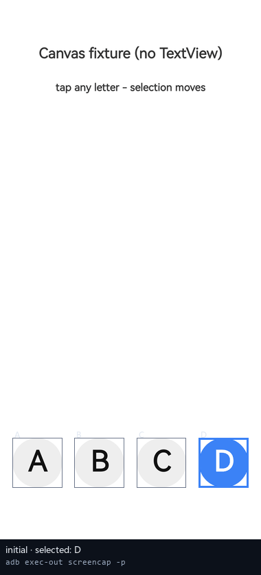
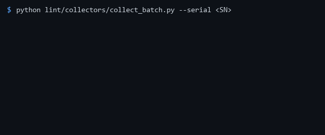
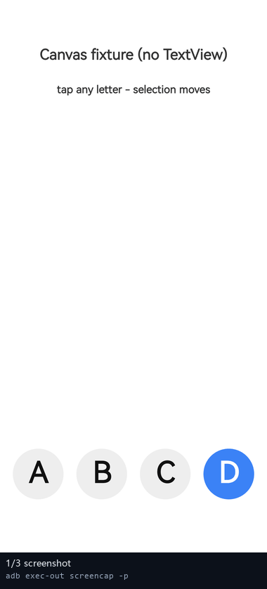

# UI Accessibility Audit & Automation Toolkit (demo)

**A read-only Android UI accessibility auditor plus a small JSON-driven flow engine.**
The auditor quantifies how much of an interface is exposed to accessibility services
(label distance, tap-target size, pages with zero interactive nodes) without clicking anything.
The engine operates pages whose accessibility tree is empty, using screenshot geometry,
normalized template matching and OCR, and verifies every action visually.
No root, no instrumentation, no network access.

Real-device recording of the visual loop: locate four buttons → tap → re-detect the selected state.



## Layout

```
ui-a11y-audit/
├── adbkit/   shared primitives: device discovery, UI-tree dump, density, screenshot hash
├── lint/     audit package: UI tree → metrics → reports (read-only, never taps)
├── engine/   flow engine: JSON flows → adb (dry-run by default) + fault injection + OCR/vision
└── fixtures  two demo apps: interactive Canvas app, read-only accessibility counter
```

`lint` and `engine` depend only on `adbkit`; neither imports the other, so the packages split cleanly.

## Glossary

| Term | 中文 | Meaning |
|---|---|---|
| fixture | 夹具 | A fixed, repeatable test double: fake XML dumps, a demo app, a counting service |
| accessibility service | 无障碍服务 | Android API that exposes other apps' UI to readers and automation |
| UI tree | 界面树 | The node hierarchy returned by `uiautomator dump`: text, bounds, clickable flags |
| label distance | 标签距离 | 0 = the control carries its own label; n = an ancestor n levels up provides it |
| tap target | 点击区 | The tappable area of a control; below 48dp is considered undersized |
| no-interactive page | 无可操作节点页 | A page whose interactive node count is zero (canvas or image-rendered UI) |
| flow | 流程 | A JSON list of steps (`launch` / `wait_text` / `tap_text` / `assert_changed` …) |
| dry-run | 干跑 | Parse and locate only; no tap is performed unless `--allow-taps` is passed |
| trace | 轨迹 | One JSON line per step: index, operation, result, detail |
| capability allowlist | 能力白名单 | Packages/components the engine may drive; everything else is refused |
| fault injection | 故障注入 | Deliberate delay / node drop / anchor hiding, used to measure robustness |
| redaction | 脱敏 | Masking page-derived text in traces (`--redact`) |

## Metrics

| Metric | Definition |
|---|---|
| `label_dist` | 0 = own label; n = ancestor level providing it; -1 = nothing within 4 levels |
| `unlabeled` | Interactive controls with `label_dist == -1` |
| `undersized` | Interactive controls whose width or height is between 24 and 48 dp |
| `tiny` | Below 24 dp; counted separately as decoration |
| `invisible` | Zero-width or zero-height bounds; excluded from the two metrics above |
| `no_interactive` | Pages with zero interactive controls (suspected canvas/image UI) |

## Measured results

26 pages / 10 apps / 245 interactive controls:

| Item | Value |
|---|---|
| Truly unlabeled (no label within 4 levels) | 0 (0.0%) |
| Relying on row/ancestor labels (distance ≥1) | 23 (9.5%) |
| Tap targets 24–48 dp | 42 (17.1%) |
| Pages with zero interactive nodes | 1 (3.8%, canvas-rendered) |
| Node-count jitter over 8 consecutive dumps | 0% |
| Single dump latency | 1.86 s |
| OCR recall vs accessibility text (114 strings) | 71.9% |



Method notes and the three corrections that changed the conclusion: `lint/docs/FINDINGS.md`,
`lint/docs/EXPERIMENT_M1_5.md`.

## Dependencies

```bash
pip install -r requirements.txt   # numpy + Pillow, only needed by the vision channel and tools/
```

The collector (`lint/`) and the flow engine (`engine/engine.py`) need Python 3.8+ and `adb` only.

## Usage'

```bash
# collect (read-only, page list in collectors/pages.json)
python lint/collectors/collect_batch.py --serial <SN> --fresh
# reports: report.md / matrix.csv / pages.csv / chart.svg / report.html
python lint/analyze/analyze.py lint/data/lint.jsonl
# flow engine (dry-run by default)
python engine/engine.py engine/flows/settings-demo.json --serial <SN>
# fault-injection benchmark
python engine/bench.py --serial <SN> --n 5
# vision channel: connected components → tap → visual verification
python engine/vision_demo.py --serial <SN>
# OCR channel: recognize text → tap its bounding box
python engine/ocr_tap_demo.py --serial <SN>
```

## Second channel: OCR

When the accessibility tree carries no text, the engine falls back to OCR (Windows built-in
engine, zh-Hans-CN). Recognized words keep their bounding boxes, so a label can be tapped directly.



Measured recall against accessibility text: **71.9%** over 114 strings across 7 pages.

## Offline checks (no device required)

```bash
python lint/tests/selftest.py
python engine/tests/selftest_engine.py
```

Windows: `powershell -ExecutionPolicy Bypass -File .\verify.ps1` runs all eight checks
(fixture self-tests, schema, privacy, baseline, engine self-test, two CLI/input contracts,
and the overlay policy).

## Exit codes

| code | meaning |
|---|---|
| 0 | success |
| 1 | assertion or gate failure |
| 2 | bad input (missing file, invalid JSON, no device) |
| 3 | device unavailable |
| 4 | output file locked by another collector |
| 5 | nothing collected (no page matched, or every page was skipped) |
| 6 | flow rejected by validation |

## Stability

```bash
python tools/soak.py --serial <SN> --dumps 30        # dump latency and failure rate
python tools/soak.py --serial <SN> --writers 3 --out data/soak.jsonl   # lock contention
```

The collector takes a lock file next to its output: concurrent runs would silently drop
records on Windows, so a second writer exits with code 4. `--force` takes over a stale lock.

## Design rules

- **read-only by default** — the collector never taps, types or submits
- **dry-run by default** — the engine taps only with an explicit `--allow-taps`
- **capability allowlist** — `engine/capabilities.json` defines the allowed targets
- **no fixed sleeps in flow execution** — waiting is state polling (`settle_text`); recording scripts use fixed delays only to time screenshots
- **data minimization** — metrics carry counts only; screenshots and traces stay in `data/` (gitignored)
- **pseudonymous devices** — records store a hash of the hardware serial, never the serial itself
- **redaction by default** — traces mask page-derived text unless `--no-redact` is passed
- **local cleanup** — `python tools/clean_local.py` removes screenshots and traces on demand'
- **input validation** — flow fields are charset-checked, unknown operations are refused

## Documents

| Document | Content |
|---|---|
| `docs/ARCH.md` | layering and data flow |
| `docs/CASE-canvas.md` | one canvas page as seen by both packages |
| `docs/BENCH.md` / `docs/BENCH-NOTES.md` | fault-injection benchmark and reading |
| `docs/AUDIT.md` | full audit: seven findings and fixes |
| `docs/ARTICLE.md` | technical write-up (Chinese) |
| `docs/ROADMAP.md` | next steps |
| `lint/docs/DECISIONS.md` | ADRs, including the end-side channel decision experiment |

## Intended use

This toolkit is meant for auditing interfaces the operator owns or is authorised to test,
and for building UI tests against apps in development. The flow engine ships with a
capability allowlist; driving arbitrary third-party apps is out of scope.

## License

MIT, see `LICENSE`.